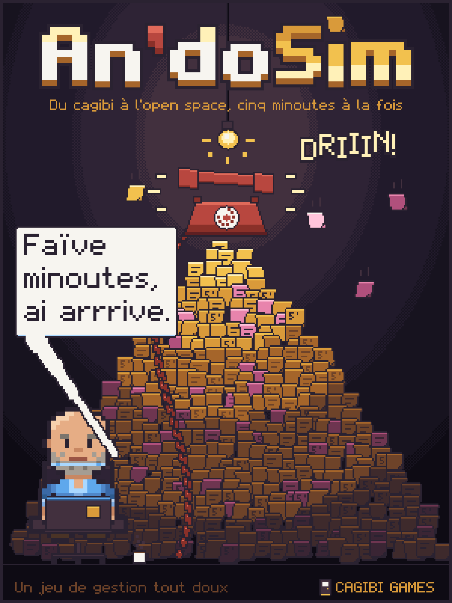
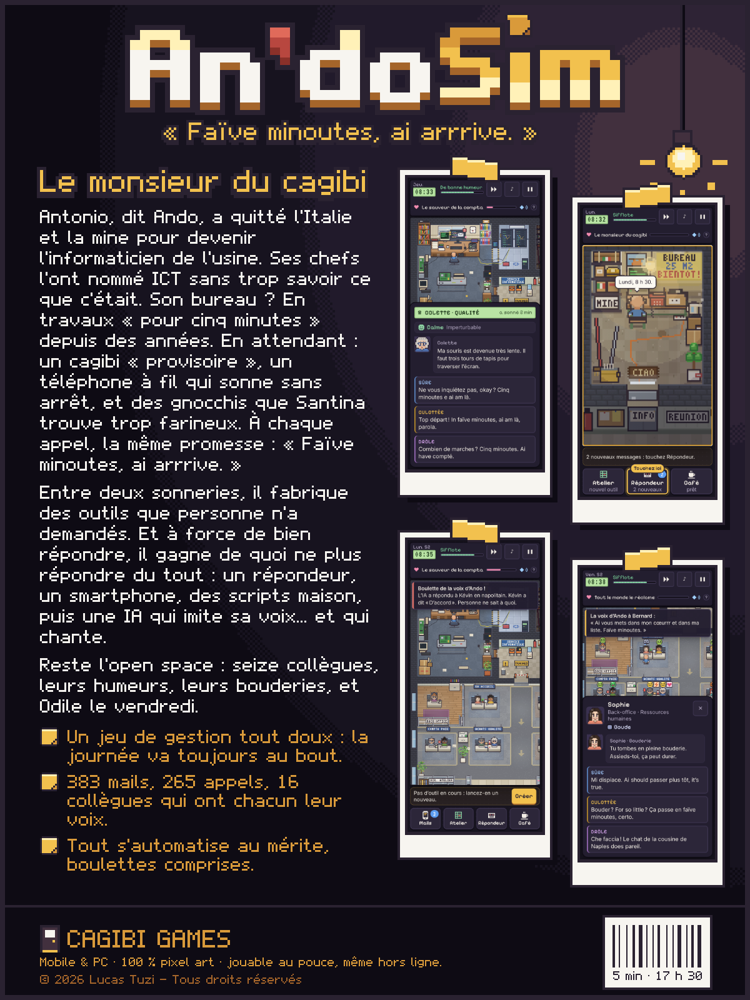

# An'doSim — le jeu

> « Cinq minoutes, ja arrrive. »

 

Antonio, dit Ando, a quitté l’Italie et la mine pour devenir l’informaticien de l’usine. Son bureau est en travaux « pour cinq minutes » depuis des années ; en attendant, il s’installe au cagibi. Le téléphone sonne, les mails s’empilent, et Ando n’a qu’une réponse : cinq minoutes.

**Jouer :** https://tuzilucas.github.io/SantiMulator---Jeu/

Sur Android, ouvrez le lien dans Chrome, puis Menu ⋮ → « Installer l’application » pour l’avoir sur l’écran d’accueil, en plein écran et hors ligne.

Ce dépôt ne contient que la version compilée du jeu, publiée avec GitHub Pages.

## Notes de mise à jour

### 1.2 « An'doSim » (15/10/2026)
- Le jeu s'appelle désormais **An'doSim**, et son héros **Ando** (Antonio, venu d'Italie). Vos parties en cours se rechargent telles quelles.
- Nouvelle introduction au cagibi : la mine, le poste d'informaticien, le bureau en travaux « pour cinq minutes ».
- Certains matins, Ando arrive grognon : Santina trouve ses gnocchis trop farineux.
- Ando est plus petit que ses collègues (et toujours aussi sûr de lui).
- Nouvelle jaquette.
- La messagerie se rouvre après une coupure, la note du matin tient en paysage, et le vendredi ne pénalise plus une semaine réussie.

### 1.1 « Retours clairs » (15/10/2026)
- La partie reprend à l'heure exacte après une coupure (appel, visite, atelier, bilan, vendredi, scènes) : rien n'est perdu ni compté deux fois.
- Une seule consigne à la fois à l'écran.
- Plus aucun texte coupé, et les messages ne cachent plus ni boutons ni texte (téléphone, tablette, PC).
- Des retours qui disent vrai : verdict de l'atelier, visites, bilan du soir, entretien du vendredi.
- Une légende pour la réputation et les points de recherche (touchez la rangée en haut).
- Vouvoiement et tutoiement respectés partout, élisions et accords corrigés.

---

© 2026 Lucas Tuzi – Tous droits réservés.
